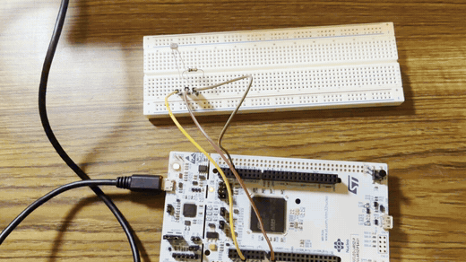
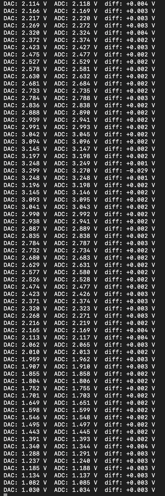
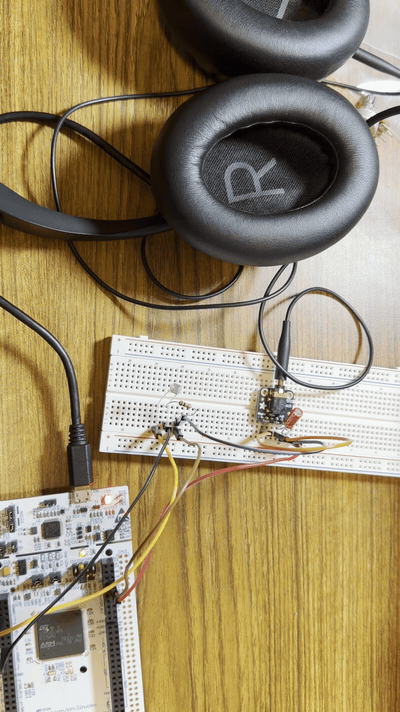

# EE186 Lab 4: Bit by Bit, Hertz by Hertz

Board: NUCLEO-L4R5ZI-P (STM32L4R5ZITxP). `Src/main.c` picks which part runs: uncomment one `run_...()` call at a time.

## 2. ADC

### 2a.

_What bit resolutions can the ADC be set to? What is the maximum sampling rate at each? Where is this in the datasheet?_

TODO

### 2b.

_Why do we need a voltage divider circuit? What would happen if the photodiode were connected directly to the board?_

TODO

### 2c.

_Circuit diagrams for both configurations, each showing Vin, Vout, and GND._

Potentiometer as a variable voltage divider:

Photodiode and 10 kΩ resistor voltage divider:

### 2d.

_Video of the ADC output changing in the terminal as the light changes, plus the code._

[Full demonstration video (.mov)](part2-adc/videos/adc_light_original.mov)

Code: [part2-adc/adc.c](part2-adc/adc.c), [part2-adc/adc.h](part2-adc/adc.h)

TODO

## 3. DAC

### 3a.

_If B = 9, what is Vout in terms of Vref, using the DAC mode with the best resolution?_

TODO

### 3b.

_Screenshot of the serial terminal printing DAC, ADC, and their difference as voltages while the DAC ramps up and down._

Code: `run_part3_loopback()` in [part3-dac/dac.c](part3-dac/dac.c)

TODO

### 3c.

_How does the DAC sampling rate affect the quality of the output waveform? How do sine, square, and sawtooth waves sound different? Why do we need a capacitor in the signal path to a speaker or earphones?_

TODO

### 3d.

_Code generating middle C (262 Hz), and a logic analyzer screenshot of the sine wave._

Code: `sine_start()` and `run_part3_sine()` in [part3-dac/dac.c](part3-dac/dac.c), [part3-dac/dac.h](part3-dac/dac.h)

TODO

## 4. Musical Instrument

_Video of the working theremin, plus the source code. Extra credit for musical or harmonic sounds._

[Full demonstration video (.mov)](part4-musical-instrument/videos/theremin_original.mov)

Code: [part4-musical-instrument/theremin.c](part4-musical-instrument/theremin.c), [part4-musical-instrument/theremin.h](part4-musical-instrument/theremin.h)

TODO
