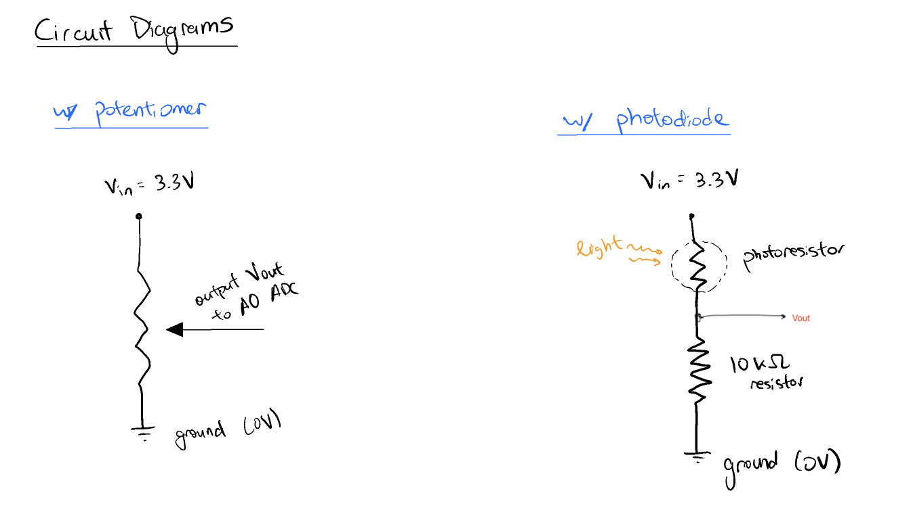
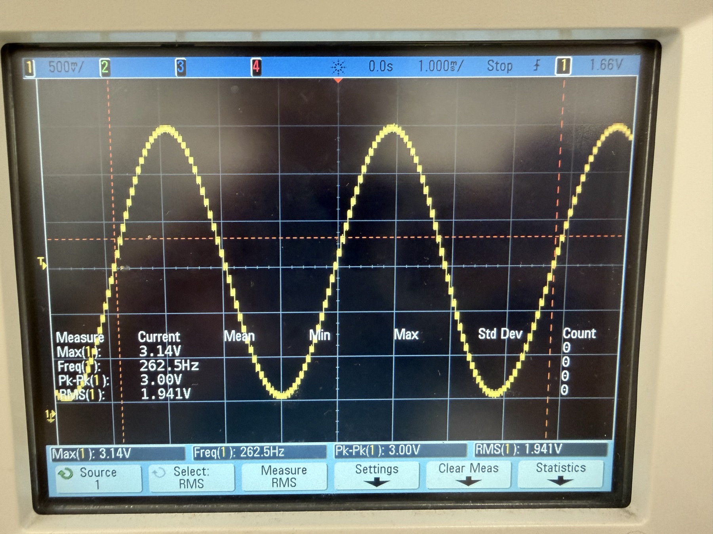

# EE186 Lab 4: Bit by Bit, Hertz by Hertz

## 2. ADC

### 2a.

The ADC can be set to 12, 10, 8, or 6 bits. Fewer bits means fewer successive-approximation steps, so each conversion takes fewer ADC clock cycles and the maximum sampling rate goes up. One conversion takes 2.5 cycles of sampling plus (resolution + 0.5) cycles of conversion. At the maximum ADC clock of 80 MHz:

| Resolution | Cycles per conversion | Max sampling rate |
| --- | --- | --- |
| 12 bits | 15 | 5.33 Msps |
| 10 bits | 13 | 6.15 Msps |
| 8 bits | 11 | 7.27 Msps |
| 6 bits | 9 | 8.88 Msps |

The cycle counts are from Table 132, "TSAR timings depending on resolution", in the reference manual (RM0432 on pg. 647). The ADC clock and sampling rates are in Table 82, "ADC characteristics", in the datasheet (DS12023 on pg. 218).

### 2b.

The ADC only measures voltage, but the light sensor responds to light by changing its resistance, and not like changing the voltage. Putting it in series with the 10 kΩ resistor between 3.3 V and ground makes a voltage divider, so the voltage at the midpoint depends on the ratio of the two resistances. More light lowers the sensor's resistance, which pulls the midpoint closer to 3.3 V, and that is what A0 reads.

If the sensor were connected directly to the pin with no resistor, the ADC input would draw almost no current, so there would be no voltage drop across the sensor and the pin would read about 3.3 V no matter how bright it is.

### 2c.

Left is the potentiometer as a variable voltage divider, and right is the photoresistor with the 10 kΩ resistor.

### 2d.

[Full demonstration video (.mov)](part2-adc/videos/adc_light_original.mov)

Code in part 2).

## 3. DAC

### 3a.

The best resolution the DAC offers is 12 bits, so n = 12:

Vout = (B / 2^n) × Vref = (9 / 4096) × Vref ≈ 0.0022 × Vref

With Vref = 3.3 V that is about 7.3 mV.

### 3b.

The DAC output (D13) is jumpered to the ADC input (A0). The DAC steps up to its maximum and back down, and each line shows the voltage we set, the voltage the ADC read back, and their difference. The two agree within about 2 to 4 mV.

### 3c.

The DAC output is a staircase, not a smooth curve. A higher sampling rate gives more, smaller steps per period, so the staircase follows the real waveform more closely and the leftover step noise is pushed to higher frequencies we can't hear. If the rate is too low the wave is blocky and sounds harsh, and below twice the signal frequency it can't represent the wave at all.

A sine is a single frequency with no harmonics, so it sounds pure and soft. A square wave adds the odd harmonics (3f, 5f, ...), which makes it sound hollow and buzzy. A sawtooth has every harmonic (2f, 3f, ...), so it is the brightest and harshest of the three.

The DAC only outputs between 0 and Vref, so the audio signal sits on a DC offset of about Vref / 2. The capacitor blocks that DC and passes only the changing part. Without it, a constant current would flow through the earphone coil, which makes no sound and just loads the DAC.

### 3d.

Code is in part 3) in the code submitted.

## 4. Musical Instrument

[Full demonstration video with sound (.mov)](part4-musical-instrument/videos/theremin_original.mov)

Code is in part 4 code.
